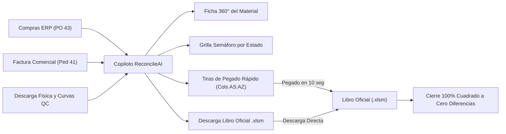

# 🛡️ ReconcileAI — Conciliación de Inventarios 3-Way & Auditoría de Recepción
### Copiloto Inteligente para Logística, Control de Calidad y Cierres de Importación

**Español** | [**English**](README.md) | [**Wiki Operativa & Tutorial**](docs/WIKI.md) | [**Notas de la Versión (Demo v1.0.0)**](docs/RELEASE_NOTES_DEMO.md) | [**SOP Recepción SAP**](docs/SOP_RECEPCION_SAP.md)

---

## 🌟 Versión Demo v1.0.0 (Edición Portable Independiente)

> [!TIP]
> **Cero Instalación:** ReconcileAI se distribuye como un **paquete ejecutable portable** (`ReconcileAI_Portable.zip`). Funciona de inmediato en Windows 10/11 **sin requerir instalación previa de Python ni permisos de Administrador**.

Un motor de cálculo y copiloto interactivo de nivel empresarial para la **Conciliación 3-Way de Inventarios y Cierres de Importación**. Diseñado para eliminar el cruce manual entre Órdenes de Compra (PO), Facturas Comerciales/DUA, Conteos Físicos de Calidad en Muelle y Movimientos Contables ERP (`Mov 101`).



---

## 🎯 Resumen Ejecutivo & Propuesta de Valor

En la logística de distribución internacional y centros de distribución, el cierre de un contenedor de importación requiere contrastar datos de fuentes heterogéneas:
1. **Capa Comercial / ERP:** Órdenes de Compra (`PO 43`) y Factura de Nacionalización (`Ped. 41`).
2. **Capa Física de Muelle:** Descarga de bultos/cartones y reporte de Control de Calidad con curvas de tallas.
3. **Capa Contable:** Ingresos a almacén en ERP (`SAP Mov 101`).

### La Problemática Operativa en Bodega
- **Desfase de Granularidad:** La factura y las macros corporativas operan al nivel de **Prepack Padre (`PRK`)**, mientras que el muelle audita **SKUs Hijos individuales (`UN`)**.
- **La Trampa de los `-51,926` en Excel:** Las macros iniciales de SAP no extraen los bultos ni unidades de muelle, dejando las columnas en cero y calculando diferencias artificiales masivas que obligan a los operadores a llenar cientos de celdas a mano celda por celda.
- **Fatiga Matemática:** Cruzar curvas complejas de 6 a 12 tallas por estilo provoca fácilmente errores de cálculo, notas de crédito improcedentes o atrasos en la liquidación administrativa.
- **Columnas Desplazadas:** En la práctica real, los operadores de calidad suelen insertar columnas en sus plantillas (como agregar `"Tarima"` en la columna B), rompiendo las fórmulas tradicionales de `BUSCARV` en Excel.

### La Solución: Copiloto ReconcileAI
- **Cruce Heurístico Determinista:** Agrupa tallas hijas bajo su lista de materiales (BOM) respetando la curva de compra ($100\%$ de precisión sin discrepancias).
- **Auto-Reparación de Fórmulas Corruptas:** Detecta fórmulas borradas o sobreescritas por error en la plantilla oficial (ej. columna H, AU y AZ) y las restaura automáticamente.
- **Tiras de Pegado Rápido (`ZDESCARGA` & `PACKING LIST`):** Genera los bloques de texto listos para pegar en las columnas **`AS:AT`** y **`AW:AY`**, cuadrando la macro oficial a **cero diferencias en 10 segundos** sin modificar fórmulas.
- **Exportación en 1 Clic del Libro Oficial (.xlsm):** Genera directamente en memoria el archivo Excel oficial cuadrado, preservando intactas todas las macros VBA y el formato original.
- **Ficha 360° del Material (Cero Desplazamiento):** Muestra compras, factura, físico, curvas y costos en una sola pantalla visual.
- **Validador de Portapapeles Pre-Macro:** Audita y desactiva la notación científica (`1.45E+06`) y limpia textos copiados desde el GUI de SAP (`ME80FN`, `MB51`) antes de llevarlos a Excel.

---

## 🚀 Inicio Rápido (En 1 Clic)

### Opción A: Paquete Portable Independiente (Recomendado para Demo)
*Ideal para computadoras de oficina o bodega sin Python ni permisos de Administrador.*
1. Descomprime **`ReconcileAI_Portable.zip`** (o utiliza la carpeta `dist/ReconcileAI`).
2. Haz doble clic en **`ReconcileAI.exe`** (o en `INICIAR_RECONCILEAI.bat`).
3. Tu navegador web se abrirá automáticamente en `http://localhost:8501`.

### Opción B: Ejecución con Python Local
*Para desarrolladores o personalización del código.*
```bash
# 1. Configurar entorno y dependencias automáticamente
preparar_equipo.bat

# 2. Iniciar el copiloto web
iniciar_asistente.bat
# o directamente: streamlit run app.py
```

### Opción C: Auditoría Ultrarrápida por Consola (CLI)
*Para auditorías directas en 1 segundo por terminal.*
```bash
python cli.py -i IMP-182
# o especificando archivos directos:
python cli.py --qc ruta/a/QC.xlsm --cierre ruta/a/Cierre.xlsm
```

---

## 📋 Guía de Demostración en 2 Minutos

1. **Abrir la Aplicación:** Abre `http://localhost:8501`.
2. **Seleccionar Contenedor:** En el explorador de archivos, elige una carpeta local (ej. `data/IMP-182` o tu carpeta de importación) o arrastra tus dos libros de Excel:
   - Archivo 1: Control de Calidad / Recepción de Muelle (`Control Calidad.xlsm`)
   - Archivo 2: Plantilla Oficial de Cierre (`Copia de IMP-XXX inprogress.xlsm`)
3. **Ejecutar Auditoría:** Haz clic en **`🚀 Iniciar Auditoría de estos Archivos`**.
4. **Ver Métricas y Semáforo:**
   - Revisa la **Barra de 6 KPIs** (Bultos Teóricos vs Muelle, Unidades Facturadas vs Muelle, Diferencia Neta).
   - Revisa la **🚦 Tabla Semáforo**: Verde = 100% Cuadrado; Azul = Parte B (en tránsito o descargado en segundo lote); Rojo = Faltante real en muelle.
5. **Cuadrar el Cierre Oficial:**
   - Dirígete a la pestaña **`📋 Copiar a Excel Oficial`**.
   - Haz clic en **`⚡ Descargar Libro Oficial Cuadrado (.xlsm con Macros VBA)`** para obtener el archivo listo, o copia las tiras de texto para **`ZDESCARGA` (Cols AS:AT)** y **`PACKING LIST` (Cols AW:AY)**.
   - Resultado: La columna de diferencias en Excel pasa inmediatamente a **`0`**.

---

## 📁 Arquitectura del Repositorio

```
3-way-inventory-reconciliation/
│
├── 🚀 iniciar_asistente.bat            # Lanzador rápido Windows (fallback inteligente)
├── ⚡ ver_resumen_rapido.bat            # Lanzador para auditoría por consola (1 seg)
├── 📦 preparar_equipo.bat               # Instalador automático de entorno virtual y dependencias
├── 🖥️ app.py                           # Interfaz Web en Streamlit con modo fluido Widescreen
├── ⚡ cli.py                            # Motor CLI rápido para auditorías instantáneas
├── 🏃 run_standalone.py                # Lanzador Python independiente para PyInstaller
├── 📖 README.md                         # Documentación en Inglés
├── 📖 README.es.md                      # Documentación en Español
│
├── 📁 dist/                             # Entregables Compilados Portables (Ignorados por Git)
│   ├── ReconcileAI/                    # Carpeta portable independiente
│   │   ├── ReconcileAI.exe             # Ejecutable nativo para Windows
│   │   ├── INICIAR_RECONCILEAI.bat     # Lanzador amigable en lote
│   │   └── data/                       # Carpeta local para colocar importaciones
│   └── ReconcileAI_Portable.zip        # Archivo ZIP de distribución independiente
│
├── 📁 src/                              # Motor Central Agnóstico
│   ├── __init__.py
│   ├── config.py                       # Resolución dinámica de rutas y entorno PyInstaller
│   ├── models.py                       # Clases de datos (PrepackItem, ChildSKU, SummaryStats)
│   ├── sanitizer.py                    # Limpieza defensiva de notación científica y texto
│   ├── validator.py                    # Validación de curvas matemáticas y estados NCR
│   ├── parsers.py                      # Escaneo dinámico de columnas y extractores de Excel
│   └── engine.py                       # Motor de cruce 3-Way, auto-reparación y cálculo NCR
│
├── 📁 docs/                             # Manuales Operativos y Wiki
│   ├── WIKI.md                         # Guía de Inicio Paso a Paso y Tutorial Operativo
│   ├── RELEASE_NOTES_DEMO.md           # Notas de la versión Demo v1.0.0
│   └── SOP_RECEPCION_SAP.md            # Procedimiento Operativo Estándar de Recepción SAP
│
├── 📁 tools/                            # Herramientas de Compilación
│   └── build_exe.py                    # Script de empaquetado PyInstaller y generación ZIP
│
└── 📁 tests/                            # Batería de Pruebas Automatizadas
    ├── __init__.py
    ├── test_sanitizer.py               # Tests unitarios de sanitización
    └── test_parsers.py                 # Tests de extracción de curvas y resistencia a columnas
```

---

## 🔒 Privacidad, Seguridad y Confidencialidad

- **Diseño 100% Agnóstico:** Funciona con cualquier proveedor, cualquier ERP (SAP, Oracle, NetSuite) y cualquier centro logístico.
- **Sin Datos Confidenciales Embebidos:** El código y los repositorios no contienen nombres corporativos, credenciales ni información privada.
- **Operación 100% en Memoria Local:** Los cálculos se ejecutan exclusivamente en la memoria RAM de tu computadora. Ningún dato viaja a internet ni se almacena en servidores externos.

---

## 📄 Licencia y Créditos

Desarrollado como una iniciativa independiente de automatización y auditoría logística de cadena de suministro. Libre para uso operativo, profesional y académico bajo Licencia MIT.
