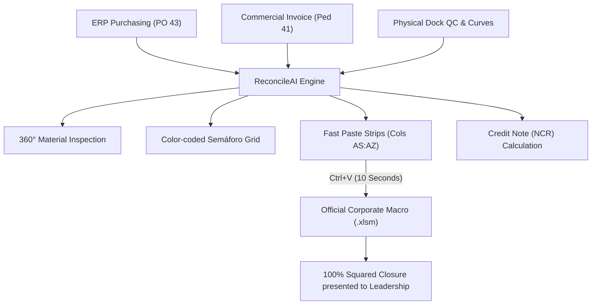

# 🛡️ 3-Way Inventory Reconciliation & Goods Receipt Auditor

[**Español**](README.es.md) | **English** | [**Operational Wiki & Tutorial**](docs/WIKI.md)

An agnostic, enterprise-grade calculation engine and interactive audit copilot for **3-Way Supply Chain Inventory Reconciliation**. Designed to eliminate manual cross-referencing between Purchase Orders (PO), Commercial Invoices/Customs Declarations, Physical Warehouse Receiving counts, and ERP Material Movements (`Mov 101`).

---

## 🎯 Executive Overview

In international retail logistics and distribution centers, closing an import container typically requires reconciling data across multiple disconnected sources:
1. **Commercial / ERP Layer:** Purchase Orders (`PO 43`) and Customs Declaration Invoices (`Invoice 41`).
2. **Physical Receiving Layer:** Warehouse dock counts, carton/bulto tallies, and Quality Control size-curve breakdowns.
3. **Accounting / Ledger Layer:** ERP inventory movements (`SAP Mov 101`).

### The Challenge
- **Granularity Mismatch:** Invoices and macros often operate at the **Parent Prepack (`PRK`)** level, while dock quality control counts items at the individual **Child SKU (`UN`)** level.
- **The Negative Formula Trap:** Default ERP spreadsheet macros often omit dock receiving and packing list tallies, causing artificial negative differences (e.g. `-51,926 UN`) that force operators to manually enter hundreds of cells line by line.
- **Human Math Fatigue:** Calculating complex size curves across dozens of styles by hand easily causes misalignments, erroneous credit note claims (NCR), or delayed nationalization closures.

### The Solution: ReconcileAI Copilot
- **Deterministic Heuristic Cross-Referencing:** Groups child SKUs under their parent BOM using mathematical curve verification ($100\%$ zero-error curve validation).
- **Dual Strip Copy-Pasting (`ZDESCARGA` & `PACKING LIST`):** Generates pre-formatted TSV text blocks for Columns `AS:AT` and `AW:AY` so operators can square the official corporate macro in **10 seconds** without altering formulas.
- **360° Material Inspector (Zero-Scroll):** Instantly displays PO quantities, invoice data, physical counts, size explosions, and unit costs on a single screen.
- **SAP Pre-Macro Clipboard Validator:** Sanitizes raw data copied from SAP GUI (`ME80FN`, `MB51`, `SE16N`), eliminating scientific notation (`1.45E+06`) and column shifts before pasting.

---

## 🚀 Quickstart Guide

### Option A: Interactive Web Copilot
Double-click `iniciar_asistente.bat` or run:
```bash
streamlit run app.py
```
- Open your browser at `http://localhost:8501`.
- **Zero Company Lock-in:** The app boots to a clean file explorer. Select any local folder or drag-and-drop your Quality Control and Closure spreadsheets.

### Option B: Fast Terminal Audit (1 Second)
Double-click `ver_resumen_rapido.bat` or run:
```bash
python cli.py
```
Or pass specific files:
```bash
python cli.py -i IMP-182
python cli.py --qc path/to/QC.xlsm --cierre path/to/Cierre.xlsm
```

---

## 📁 Repository Architecture

```
3-way-inventory-reconciliation/
│
├── 🚀 iniciar_asistente.bat            # One-click Windows launcher for Web UI
├── ⚡ ver_resumen_rapido.bat            # One-click Windows launcher for CLI audit
├── 🖥️ app.py                           # Fullscreen Streamlit UI with Dark/Light theme
├── ⚡ cli.py                            # Fast command-line reconciliation engine
├── 📖 README.md                         # English Documentation
├── 📖 README.es.md                      # Spanish Documentation
│
├── 📁 src/                              # Agnostic Core Engine
│   ├── __init__.py
│   ├── config.py                       # Dynamic path discovery & environment helpers
│   ├── models.py                       # Dataclasses: PrepackItem, ChildSKU, SummaryStats
│   ├── sanitizer.py                    # Defensive data cleaning (scientific notation, strings)
│   ├── validator.py                    # Business rules, curve sum checks & discrepancy logic
│   ├── parsers.py                      # Multi-sheet Excel parsers (openpyxl / xlrd)
│   └── engine.py                       # 3-Way matching logic and NCR calculation
│
├── 📁 docs/                             # Guides, Wiki & Operational Manuals
│   ├── WIKI.md                         # Comprehensive Starting Guide & Tutorial
│   └── SOP_Conciliacion_3Way.md        # Standard Operating Procedure (SOP)
│
└── 📁 tests/                            # Automated Test Suite
    ├── __init__.py
    └── test_sanitizer.py               # Unit tests (100% passing)
```

---

## 🛠️ Key Capabilities & Workflow



1. **Clean File Explorer:** Browse local folders or drag-and-drop spreadsheets directly without rigid naming constraints.
2. **Pre-Macro Clipboard Validation:** Validates tab-separated text copied from SAP before pasting into Excel.
3. **Instant Closure Strips (`AS:AZ`):** Solves the `-51,926` negative variance trap by generating ready-to-paste TSV blocks.
4. **Physical Folder Checklist:** Interactive 7-step tracker for physical binder submission.

---

## 🧪 Running Automated Tests

To run the defensive sanitization test suite:
```bash
python -m pytest tests/test_sanitizer.py
```

---

## 📄 License & Attribution

Developed as an independent, enterprise-grade supply chain automation tool. Free for professional and educational use.
