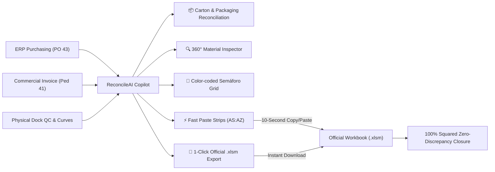

# 🛡️ ReconcileAI — 3-Way Inventory Reconciliation & Goods Receipt Auditor
### Enterprise Copilot for Supply Chain, Quality Control & Import Closures

[**Español**](README.es.md) | **English** | [**Operational Wiki**](docs/WIKI.md) | [**Release Notes**](docs/RELEASE_NOTES_DEMO.md) | [**SAP Receiving SOP**](docs/SOP_RECEPCION_SAP.md) | [**Cartons & VBA Audit**](docs/CONOCIMIENTO_EMPIRICO_BULTOS_MACROS.md) | [**Dispatch Architecture**](docs/AUDITORIA_DESPACHO_MACRO.md)

---

## 🌟 Standalone Portable Edition (v1.1.0)

> [!TIP]
> **Zero Installation Required:** ReconcileAI is packaged as a **100% portable standalone distribution** (`ReconcileAI_Portable.zip`). It runs out of the box on Windows 10/11 **without requiring a Python installation or administrator privileges**.

An agnostic, enterprise-grade calculation engine and interactive audit copilot for **3-Way Supply Chain Inventory Reconciliation**. Designed to eliminate manual cross-referencing between Purchase Orders (PO), Commercial Invoices/Customs Declarations, Physical Warehouse Receiving counts, and ERP Material Movements (`Mov 101` and `Mov 641`).



---

## 🎯 Executive Overview & Value Proposition

In international retail logistics and distribution centers, closing an import container typically requires reconciling data across multiple disconnected sources:
1. **Commercial / ERP Layer:** Purchase Orders (`PO 43`) and Customs Declaration Invoices (`Invoice 41`).
2. **Physical Receiving Layer:** Warehouse dock counts, carton/bulto tallies, and Quality Control size-curve breakdowns.
3. **Accounting / Ledger Layer:** ERP inventory movements (`SAP Mov 101` for Goods Receipt and `SAP Mov 641` for Store Transfers).

### The 3 Independent Numerical Levels in Supply Chain
ReconcileAI enforces mathematical segregation across the three levels of inventory data:
* **Level 1 — Physical Cartons (Bultos Físicos):** Boxes physically handled at the dock (Col `AS`), Vendor Packing List cartons (Col `AW`), and Quality Control count (`Enteros` + `Complementos`).
* **Level 2 — Prepacks / Commercial Assortments (PRK / Curva):** Ordering unit for assortments (Col `BD` and `BE` in PRKs, Col `BB` Curve ratio, Col `BC` UoM).
* **Level 3 — Total Pieces (Unidades Totales):** Invoiced and nationalized garments (Col `F`, `G`, `H`, `AT`, `AX`).

### Key Operational Capabilities
- **Compound Packaging String Parsing:** Parses scalar numbers (`42`) as well as compound cartons with odds/picos (e.g. `'39*60 1*78'` $\rightarrow$ 39 boxes of 60 + 1 box of 78 = 40 cartons, 2,418 units).
- **Dedicated Carton Reconciliation Tab (`📦 Cuadre & Desglose de Bultos`):** Top 5 KPI cards, interactive packaging calculator, and 1-to-1 official `'Bultos'` sheet replica.
- **Dual-Phase Architecture (Reception & Dispatch):** Pre-wires and synchronizes both Reception Closures (`CIERRE RECEP`) and Dispatch Closures (`CIERRE DESP`, `Check list DESPACHO`, `STOCK CONTROL DE INVENTARIO`, `Mov 641`).
- **Self-Healing Spreadsheet Recovery:** Detects deleted, overwritten, or corrupted formulas in official closure workbooks and automatically repairs them.
- **Dual Strip Copy-Pasting (`ZDESCARGA` & `PACKING LIST`):** Generates pre-formatted TSV text blocks for Columns `AS:AT` and `AW:AY` so operators can square official corporate macros in **10 seconds**.
- **1-Click Official `.xlsm` Export:** Automatically generates the finalized, fully-squared official Excel file in memory with all VBA macros intact.
- **Bilingual Interface (Spanish Default / English Optional):** Complete UI translation and dynamic client-side translation for data table toolbar tooltips.

---

## 🚀 Quickstart Guide

### Option A: Portable Standalone Executable (Recommended for Workstations)
*Ideal for office or warehouse computers without Python or admin rights.*
1. Unpack **`ReconcileAI_Portable.zip`** (or use the `dist/ReconcileAI` folder).
2. Double-click **`ReconcileAI.exe`** (or `INICIAR_RECONCILEAI.bat`).
3. Your default web browser will open automatically at `http://localhost:8501`.

### Option B: Local Python Development
*For developers and local customization.*
```bash
# 1. Clone repository
git clone https://github.com/D4RKL0RD-J0571N/3-way-inventory-reconciliation.git
cd 3-way-inventory-reconciliation

# 2. Run automated setup (creates virtual environment & installs dependencies)
preparar_equipo.bat

# 3. Launch interactive copilot
iniciar_asistente.bat
# or: streamlit run app.py
```

### Option C: 1-Second Terminal Audit (CLI Mode)
*For headless batch verification and terminal lovers.*
```bash
python cli.py -i CONT-001
# or specify direct paths:
python cli.py --qc path/to/QC_Receiving.xlsm --cierre path/to/Official_Closure.xlsm
```

---

## 📋 2-Minute Demo Walkthrough

1. **Launch the App:** Open `http://localhost:8501`.
2. **Select Container:** In the file explorer, choose a local folder (e.g. `data/CONT-001` or your own container folder) or drag and drop your two Excel files:
   - File 1: Quality Control / Dock Receiving (`Dock_QC_Receiving.xlsm`)
   - File 2: Official Closure Template (`Official_Closure.xlsm`)
3. **Run Audit:** Click **`🚀 Iniciar Auditoría de estos Archivos`**.
4. **Audit Cartons & Packaging:**
   - Go to **`📦 Cuadre & Desglose de Bultos`** to compare dock cartons vs vendor packing list cartons, use the packaging calculator, and verify the `'Bultos'` sheet.
5. **Inspect Styles & Discrepancies:**
   - Use the **`🔍 Ficha 360° Material`** to inspect parent-child curves and unit costs without scrolling.
   - Check the **`🚦 Tabla Semáforo`**: Green items are 100% matched; Blue items indicate split shipments (Parte B); Red items indicate actual physical shortages.
6. **Square the Official Closure:**
   - Go to **`📋 Copiar a Excel Oficial`**.
   - Either click **`⚡ Descargar Libro Oficial Cuadrado (.xlsm con Macros VBA)`** to download the completed file, or copy the pre-formatted text blocks for **`ZDESCARGA` (Cols AS:AT)** and **`PACKING LIST` (Cols AW:AY)** into your official workbook.
   - Result: Discrepancy column instantly drops to **`0`**.

---

## 📁 Project Architecture

```
3-way-inventory-reconciliation/
│
├── 🚀 iniciar_asistente.bat            # One-click Windows launcher (smart fallback)
├── ⚡ ver_resumen_rapido.bat            # One-click CLI quick auditor
├── 📦 preparar_equipo.bat               # 1-click venv & dependencies setup
├── 🖥️ app.py                           # Fullscreen Streamlit UI (Widescreen Fluid Layout)
├── ⚡ cli.py                            # Fast command-line reconciliation engine
├── 📄 generar_cierre_oficial.py        # Automated .xlsm builder with preserved VBA macros
├── 🏃 run_standalone.py                # Standalone Streamlit launcher for PyInstaller
├── 📖 README.md                         # English Documentation & Demo Guide
├── 📖 README.es.md                      # Spanish Documentation & Demo Guide
│
├── 📁 dist/                             # Compiled Standalone Deliverables (Git-ignored)
│   ├── ReconcileAI/                    # Standalone executable folder
│   │   ├── ReconcileAI.exe             # Native Windows executable
│   │   ├── INICIAR_RECONCILEAI.bat     # Friendly batch launcher
│   │   └── data/                       # Container files directory
│   └── ReconcileAI_Portable.zip        # Portable standalone distribution archive
│
├── 📁 src/                              # Core Agnostic Reconciliation Engine
│   ├── __init__.py
│   ├── config.py                       # Dynamic path discovery & PyInstaller environment resolution
│   ├── models.py                       # Dataclasses: PrepackItem, PackagingBreakdown, SummaryStats
│   ├── sanitizer.py                    # Defensive data cleaning (scientific notation, strings)
│   ├── validator.py                    # Business rules, curve sum checks & discrepancy logic
│   ├── parsers.py                      # Dynamic header scanner & compound packaging string parser
│   ├── engine.py                       # 3-Way matching logic, carton balance & NCR calculation
│   ├── i18n.py                         # Centralized internationalization (ES/EN)
│   └── ui_helpers.py                   # Responsive CSS shimmers & virtual pagination
│
├── 📁 docs/                             # Operational Manuals & Technical Architecture
│   ├── CONOCIMIENTO_EMPIRICO_BULTOS_MACROS.md # Empirical knowledge base on cartons & VBA macros
│   ├── AUDITORIA_DESPACHO_MACRO.md     # Dispatch closure architecture & Mov-641 synchronization
│   ├── WIKI.md                         # Comprehensive Starting Guide & Demo Tutorial
│   ├── RELEASE_NOTES_DEMO.md           # Release Notes
│   └── SOP_RECEPCION_SAP.md            # Standard Operating Procedure (SAP Goods Receipt)
│
├── 📁 tools/                            # Build & Packaging Utilities
│   └── build_exe.py                    # Automated PyInstaller onedir builder & packager
│
└── 📁 tests/                            # Automated Regression Test Suite (22/22 Passing)
    ├── __init__.py
    ├── test_sanitizer.py               # Unit tests for text & numeric sanitizer
    ├── test_parsers.py                 # Automated tests for Excel extraction & curve math
    ├── test_i18n.py                    # Tests for language translation & pagination
    └── test_bultos_empaque.py          # Tests for carton breakdown & compound packaging parsing
```

---

## 🔒 Security, Privacy & Confidentiality Guarantee

- **100% Agnostic Architecture:** Designed to work universally with any vendor, any ERP (SAP, Oracle, NetSuite), and any warehouse system.
- **Zero Company Branding or Sensitive Data:** No proprietary corporate credentials, facility codes, or confidential supplier data are baked into the codebase.
- **Local Workstation Memory:** All parsing and mathematical calculations run in temporary local memory (RAM). No data is transmitted over the Internet or persisted to third-party servers.

---

## 📄 License & Attribution

Developed as an independent, enterprise-grade supply chain automation and reconciliation copilot. Free for operational, professional, and educational use under the MIT License.
