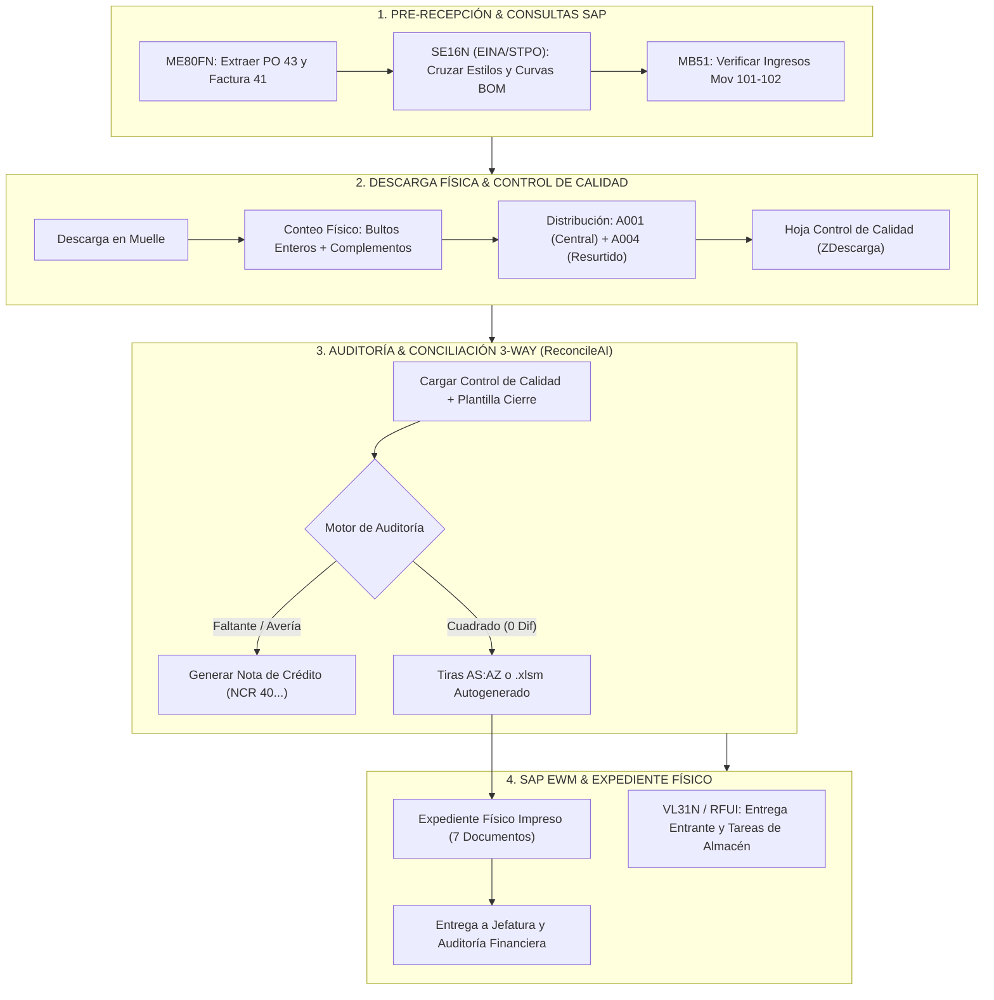

# 📦 Procedimiento Operativo Estándar (SOP): Recepción, SAP S/4HANA y Cierre 3-Way

**Estado:** Documento Maestro Integrado  
**Propósito:** Estandarizar la secuencia operativa completa desde la llegada del contenedor y consultas en SAP GUI hasta la auditoría física en muelle y el cuadre administrativo final.  
**Arquitectura:** Agnóstica, aplicable a cualquier Centro de Distribución y multi-proveedor.  
**Documentos Relacionados:** [**Wiki Operativa & Guía**](WIKI.md) | [**Notas de la Versión Demo v1.0.0**](RELEASE_NOTES_DEMO.md) | [**README**](../README.es.md)

---

---

## 🧭 1. Diccionario de Prefijos y Códigos en ERP (SAP)

| Prefijo / Código | Tipo de Documento / Objeto | Descripción Operativa |
|---|---|---|
| **`43...`** | **Orden de Compra (PO)** | Pedido emitido al proveedor internacional con las cantidades y costos negociados. |
| **`41...`** | **Factura de Proveedor / Pedido Nac.** | Documento comercial nacionalizado (DUA) que ampara la importación legal. |
| **`45...`** | **Pedido de Tienda / Traslado** | Pedidos de distribución interna hacia sucursales y puntos de venta. |
| **`40...`** | **Nota de Crédito (NCR)** | Reclamo económico al proveedor por prendas faltantes o dañadas de fábrica. |
| **`18...`** | **Entrega Entrante (Inbound Delivery)** | Documento logístico en SAP para gestionar el ingreso de la mercancía al almacén. |
| **`80...`** | **Unidad de Manipulación (HU)** | Matrícula de pallet o contenedor de empaque para mover stock en el sistema. |
| **Mov `101`** | **Entrada de Mercancías** | Ingreso físico al inventario de almacén vinculado a un pedido de compras. |
| **Mov `102`** | **Anulación de Entrada** | Reversa o corrección contable de un movimiento 101. |
| **Mov `641`** | **Salida por Traslado / Facturado** | Mercancía despachada o facturada en tránsito entre almacenes o tiendas. |
| **Mov `501`** | **Ingreso sin Pedido** | Entrada directa en tienda o almacén sin orden de compra previa. |

---

## 💻 2. Consultas Clave en SAP GUI (Aclaración de Dudas Operativas)

### 2.1. Transacción `ME80FN`: Órdenes de Compra y Facturación
* **¿Dónde pegar los números masivos?**  
  En el campo **`Documento de compras`**, haciendo clic en el botón de selección múltiple (flecha verde o `Shift + F4`). Pegas la lista de POs `43...` o la Factura `41...`.
* **¿Qué significa `UMP`?**  
  **`UMP` = Unidad de Medida de Pedido**. En retail textil representa si el ítem se compra por **`PRK`** (Prepack/Bolsa surtida) o por **`UN`** (Unidad individual suelta).
* **Tip Pro de Copiado:**  
  Copia desde la grilla ALV seleccionando las columnas hasta `UMP`. Luego pásala por la pestaña **`⚡ Validador SAP`** de ReconcileAI para desactivar la notación científica (`1.45E+06`) antes de pegarla en la macro.

### 2.2. Tablas `EINA` y `STPO` en `SE16N`: Cruce de Curvas y Prepacks
* **Tabla `EINA` (Registro Info de Compras):**  
  Relaciona el código de estilo del proveedor internacional (campo `IDNLF`) con el código de material interno de SAP (campo `MATNR`).
* **Tablas `MAST` y `STPO` (Listas de Materiales / BOM):**  
  * `MAST`: Vincula el Prepack padre con su número de lista (`LISTA / BOM ID`).
  * `STPO`: Contiene los materiales componentes (hijos/tallas) y el campo **`MENGE`** (Cantidad de componente = **Ratio de la Curva**, ej. 1, 2, 2, 1).

### 2.3. Transacción `MB51`: Movimientos de Inventario
* Se ejecuta filtrando por el **Centro Logístico** y clases de movimiento **`101 - 102`**.
* **El Balance Neto:** `Total Unidades Ingresadas = Mov 101 - Mov 102`.
* Este balance debe coincidir exactamente con el **Recibido Real en Muelle**.

---

## 📦 3. Recepción en Muelle y Control de Calidad (`ZDescarga`)

### 3.1. Conteo de Bultos: Enteros vs. Complementos
1. **Bultos Enteros:** Cajas cerradas de fábrica con la curva completa de tallas intacta.
2. **Bultos Complementos:** Cajas con unidades de ajuste, muestras o saldos sueltos.
3. **El Cuadre de Bultos en Auditoría:**  
   Se compara:
   $$\text{Diferencia de Bultos} = \text{Bultos Recibidos en Muelle} - \text{Bultos Teóricos del Packing List}$$
   *Una diferencia de bultos negativa (ej. -54) suele explicarse por consolidación de cajas en fábrica, siempre que las unidades coincidan al 100%.*

### 3.2. La Trampa del Alisto Multi-Almacén (`A001` vs `A004`)
* En bodega, las prendas recibidas se reparten físicamente:
  * **`A001` (Almacén Central):** Stock destinado a distribución inmediata.
  * **`A004` (Resurtido):** Stock de reserva en racks altos.
  * **Especiales:** Prendas separadas para eventos, tiendas insignia o promociones.
* **Regla de Oro:** Para cuadrar la importación, **siempre se debe tomar la columna `TOTAL DE UNIDADES`** (suma de A001 + A004 + Especial), nunca un alisto parcial.

---

## ⚡ 4. Cómo ReconcileAI Ataca y Previene Errores

| Error Típico en Bodega | Causa en Excel | Prevención Automática en ReconcileAI |
|---|---|---|
| **Columnas Desplazadas** | El operador inserta columnas como `Tarima` en la hoja de calidad. | **Mapeo Heurístico:** Busca los encabezados por nombre (`Material`, `UM`, `Total Unidades`), inmune a desplazamientos. |
| **Fórmulas Borradas** | Un supervisor borra la fórmula de la columna H o AU en el macro oficial. | **Auto-Sanación:** Regenera `=+G-J-N-O+L+P+Q` y `=+AT-H` automáticamente al guardar el `.xlsm`. |
| **Prepacks vs Unidades** | Se digitan bultos o PRKs en la columna de piezas sueltas (ej. 81 en vez de 1,728). | **Validación de Curva:** Multiplica los PRKs por la curva teórica y alerta sobre discrepancias de orden de magnitud. |
| **Notación Científica** | Excel convierte códigos de 10 dígitos en `1.45562E+09`. | **Sanitizador String:** Convierte floats científicos de vuelta a enteros limpios en memoria. |

---

## 🖨️ 5. Checklist Oficial del Expediente Físico (7 Documentos)

1. [x] **Portada de Proveedor:** Carátula con proveedor, número de importación (`IMP-XXX`) y fecha.
2. [x] **Datos Generales:** Resumen de POs `43...`, Factura `41...`, bultos teóricos vs recibidos.
3. [x] **Carátula del Cierre Oficial (`CIERRE RECEP`):** Tabla balanceada con diferencias en 0.
4. [x] **Formulario de Nota de Crédito (`PARA N.C RECEP.`):** Liquidación a $0.00 o detalle de faltantes.
5. [x] **Respaldo de Ingreso ERP:** Impresión de `MB51` (Mov 101/102).
6. [x] **Lista de Empaque de Bultos:** Desglose de cartones y unidades.
7. [x] **DUA (Documento Aduanero):** Copia sellada de nacionalización con valor CIF y peso.
